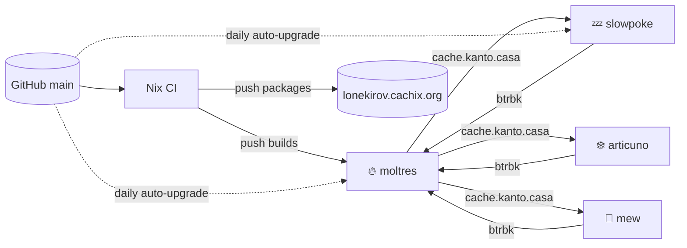

<h1 align="center">🗺️ kanto</h1>

<p align="center">
  <em>One flake for every machine in the region.</em>
</p>

<p align="center">
  <a href="https://github.com/LoneKirov/nix-config/actions/workflows/nix-ci.yml"></a>
  <a href="https://nixos.org"></a>
  <a href="https://flake.parts"></a>
  <a href="https://github.com/jj-vcs/jj"></a>
</p>

---

| | Host | Role |
|---|---|---|
| ❄️ | **articuno** | Workstation: NVIDIA, niri + Dux Shell |
| 🪟 | **articuno-wsl** | NixOS on WSL |
| 🧬 | **mew** | Framework laptop: niri + Dux Shell |
| 🔥 | **moltres** | Home server: media, SSO, binary cache, backups |
| 💤 | **slowpoke** | Raspberry Pi 3: Tailscale exit node |

Hosts and their roles are declared in [`hosts/default.nix`](hosts/default.nix); the shared modules in [`modules/`](modules) turn those roles into config. Kinds of machine, like a Raspberry Pi model, live in [`profiles/`](profiles) for host directories to import.



## 🚀 Deploying

```sh
nh os switch                                               # this machine
nh os switch --target-host moltres --build-host moltres    # a server
```

- Remote deploys build on the target, since only CI may push unsigned paths into another host's store.
- slowpoke doesn't evaluate the flake. CI records slowpoke's system on each commit to `main` once it's in the cache, and slowpoke upgrades to the one on `main`'s newest commit. After CI finishes on `main`, let it upgrade on its own or run `systemctl start nixos-upgrade` on it.

### Reinstalling a host

Each host's SSH host key is kept in `hosts/<host>/ssh_host_ed25519_key.sops.yaml`, encrypted to kirov and that host. The host's sops secrets are encrypted to this key, so a reinstall that restores it can decrypt them on first boot:

```fish
set tmp (mktemp -d)
sops decrypt --output-type binary hosts/<host>/ssh_host_ed25519_key.sops.yaml \
    | install -D -m 600 /dev/stdin $tmp/persistent/etc/ssh/ssh_host_ed25519_key
nix run nixpkgs#nixos-anywhere -- --extra-files $tmp --flake .#<host> root@<installer>
rm -r $tmp
```

A new host gets its key before its first install, so its secrets can be encrypted to it from the start:

```fish
set tmp (mktemp -d)
ssh-keygen -q -t ed25519 -N '' -C <host> -f $tmp/key
mv $tmp/key.pub keys/<host>.pub
ssh-to-age < keys/<host>.pub
```

Add that recipient to `.sops.yaml`, with a rule for `<host>/` and the host in the catch-all rule, and run `sops updatekeys` on the files the catch-all covers. Then store the key:

```fish
sops encrypt --filename-override hosts/<host>/ssh_host_ed25519_key.sops.yaml \
    --input-type binary --output-type yaml $tmp/key > hosts/<host>/ssh_host_ed25519_key.sops.yaml
rm -r $tmp
```

## 📦 Packages

CI pushes the flake's packages to a public cache, so flakes building on this one can use them without access to cache.kanto.casa:

```sh
cachix use lonekirov
```
